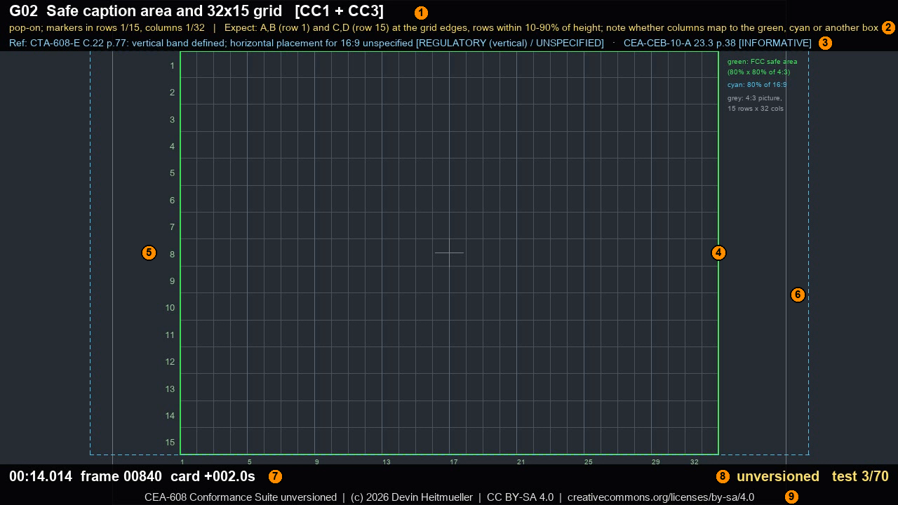

# CEA-608 Conformance Suite

## Introduction

In 2003, the CEA R4.3 Working Group 1, in cooperation with WHD-TV and the CPB/WGBH National Center for Accessible Media (NCAM), developed a series of CEA-608/708 test materials intended to exercise features of the standards and improve uniformity of presentation across commercial products.  These test clips (later made available for purchase from the CTA as the "DTVCC" assets), have been a valuable tool for television vendors as well as settop box and software based players which need to support closed captions.

As of this writing in 2026, the materials (which were distributed as 1080i59 interlaced MPEG-2 video), no longer work consistently across modern products.  This is a result of many modern products not natively supporting interlaced video, the MPEG-2 video codec, and/or various other interoperability issues.

Further, while the CEA-708 standard was well intentioned in providing an enhanced presentation experience for users, in practice for economic reasons the vast majority of captioning material created for broadcast in the United States continues to be authored in 608 and then "upconverted" to 708.  While this satisfies the FCC requirement that both formats be provided, the net effect is that very few of the 708-specific features are actually used.

## Purpose

This project intends to reimagine the original intent of the CEA project, but using modern codecs and video formats that are readily available across modern devices (H.264 encoding, 720p59 for 16:9 and 480i59 for 4:3).  It also intends to take into account later revisions to the CTA-608 and CTA-708 standards, which in numerous cases were intended to address ambiguity in earlier versions of the standard.

The primary focus is to exercise and validate the legacy CTA-608 rendering behavior, and ensure that the CTA-708 representation of that same material is consistent.  The streams are also useful for validating conversion of 608/708 captions into more modern formats such as IMSC 1.  The project specifically does not attempt to reproduce every single CEA-708 feature.

This project is in no way affiliated with the Consumer Technology Association or the other authors of the above referenced test materials.

## What you get

Two transport streams with the same 70 test cards (about 8 minutes 48 seconds each) that you play on the
decoder, player, set-top box or converter you want to check: a **16:9 stream at 720p59** and a **4:3 stream at
480i59** (standard definition, interlaced). Each card exercises one caption feature (a character set, a
positioning code, a caption style, a memory command, a signal-loss condition ...) and tells you, on screen,
**what you should see** and **which part of the specification says so**.

The streams are published as assets of each [GitHub release](https://github.com/dheitmueller/cea608-conformance-suite/releases) (download the `.ts` files from the latest one). The full list of test cards, with
the purpose of each, is in [TESTS.md](TESTS.md).

Developers who want to modify or regenerate the stream: see [DEVELOPING.md](DEVELOPING.md).
Found a problem, or want to contribute or make a derivative? See [CONTRIBUTING.md](CONTRIBUTING.md).

## The test pattern

The picture is a graticule with a banner at the top and a status bar at the bottom. The captions themselves
are **not** in the picture: your decoder draws them over it, which is exactly what is being tested.

1. **Card number, title and channels.** `G02` here; `[CC1 + CC3]` tells you the card is sent on both
   caption channels, so you can check either one.
2. **What is tested and what you should see** (after `Expect:`). Compare this with what your decoder draws.
3. **The specification reference and how binding it is** (see "Mandatory or best practice?" below).
4. **FCC safe caption area** (green): 80% x 80% of the 4:3 picture, per CTA-608-E section C.22. In the 480i59
   stream this is the whole frame, and captions should stay inside it. In the 720p59 stream the box sits in the
   center of the 16:9 frame (see "Widescreen" below).
5. **Caption grid**: rows 1-15 down the left, columns 1-32 along the bottom (ticks every 4 columns, matching
   the indent positions). Use it to check that positioning codes land on the right row and column.
6. **Reference outlines** (720p59 only): grey = the 4:3 picture; cyan dashed = 80% of the 16:9 frame. How a
   decoder maps the 4:3 caption grid onto a 16:9 picture is not defined, so both are shown.
7. **Timer**: clock time, frame number, and seconds into the current card.
8. **Version label of this build and card counter.**
9. **Author and license.**

## Using the stream

0. Pick the stream that matches your device: **720p59** for 16:9 paths, **480i59** for 4:3 / standard-definition
   paths. The cards and their timing are identical; only the picture differs (and the wording of two cards,
   below).
1. Play the stream **from the beginning** and let it run. Caption state builds up over time (a roll-up caption
   depends on the rows before it, for example), so jumping into the middle of a card can show a legitimately
   different result.
2. Select a caption channel in your decoder. **CC1** and **CC3** carry the same tests, so you can check your
   decoder's handling of either field. The first caption says `Rendering on CC1` (or CC3) so you can see which
   channel you are looking at. **CC2** and **CC4** show a continuous `Rendering on CC2` / `CC4` label, and card
   **H01** uses all four channels to check that each shows only its own text.
3. For each card, compare what your decoder draws with the `Expect:` line. The card's duration is long enough
   to read, and `TESTS.md` explains the intent in more detail.

### Mandatory or best practice?

The specifications mix requirements with recommendations, and this suite does not treat them alike. The
reference on each card ends with a tag:

| Tag | Meaning |
|---|---|
| `REGULATORY` / `NORMATIVE` | Required behavior (FCC rules as reproduced in CTA-608-E, and its normative text). A deviation is a defect. |
| `PREFERRED` | CTA-608-E states a preferred option; other reasonable choices are allowed. |
| `RECOMMENDED` | Recommended practice in CTA-608-E (mostly addressed to caption authors). |
| `10A-RECOMMENDATION` | Best practice from CEA-CEB-10-A. That document is a bulletin: its recommendations are **never mandatory**. |
| `OPTIONAL` | An optional decoder feature (e.g. extended characters, background colors). If you implement it, it should behave as described; leaving it out is not a failure. |
| `UNSPECIFIED` | The specifications do not say; the card records what your decoder does. |

### Widescreen

CTA-608-E predates widescreen and has no 16:9 provision: the safe caption area (its Figure 3 and Table 46) is
defined as a fraction of a **4:3** picture. Rows 1-15 span 10%-90% of the picture height at any aspect ratio, but
how the 32 columns map horizontally onto a 16:9 picture is not specified (the ATSC `wide_aspect_ratio` bit has
no meaning for a 608 service, A/65:2013). In the 720p59 stream, card **G02** therefore only checks the vertical
band and asks you to **note** where your decoder puts the columns (green 4:3-centered box, cyan 80% box, or
elsewhere). In the 480i59 stream the same card is a plain requirement, because there the safe area is defined.
Card **S01** (timing) also words its tolerance per format.

A few cards deliberately create error conditions (more than four rows, loss of caption data, invalid parity).
They are there because the specifications say how a decoder should respond, or because the behavior is worth
knowing.

## What is covered

| Cards | What they check |
|---|---|
| G00-G02 | Stream start, which channel is rendered, safe caption area and the 32 x 15 grid |
| C01-C04 | The basic character set, special characters, the optional extended sets (Spanish, French, Portuguese, German, Danish and symbols) and the extended-character automatic backspace |
| A01-A10 | Row addressing, colors, italics, underline, indents, tab offsets, mid-row codes, right-margin and backspace edge cases, background and foreground attributes, flash |
| P01-P05 | Pop-on captions: display, erase, off-screen loading, erase-non-displayed, more than four rows |
| R01-R11 | Roll-up captions (2, 3 and 4 rows): scrolling, base rows, indents, styles, default row, depth changes, repeated carriage returns |
| D01-D09 | Paint-on captions, backspace, delete-to-end-of-row, switching between caption styles, repeated control codes |
| S01-S05, H01 | Caption timing against the video, persistence of an idle caption, loss of caption data and invalid data, independent channels |

Not covered: CEA-708 (DTVCC) services, XDS data and Text mode (T1-T4).

## The stream

| | 720p59 (16:9) | 480i59 (4:3) |
|---|---|---|
| Container | MPEG-2 transport stream at a constant 4 Mbps | same |
| Video | H.264 High, 1280x720 progressive, 59.94 fps, square pixels, 3.5 Mbps CBR | H.264 High, 720x480 **interlaced** (top field first), 29.97 frames (59.94 fields) per second, **anamorphic** (pixel aspect 8:9, display aspect 4:3), 3.5 Mbps CBR |
| GOP | closed, 30 pictures, B-frames | closed, 15 frames, B-frames |
| Audio | AC-3 stereo, 128 kbps (a short 1 kHz beep each second) | same |
| Captions | CEA-608 as ATSC A/53 `cc_data` (ITU-T T.35 SEI). One pair per picture, alternating field 1 (CC1, CC2) and field 2 (CC3, CC4) | the same, but each frame carries **both** field pairs, field 2 first |

Either format can also be generated with MPEG-2 video instead of H.264, and without the program-table caption
descriptor; see [DEVELOPING.md](DEVELOPING.md). The program table carries an ATSC `caption_service_descriptor`
with a single entry for the CEA-608 data stream (A/65:2013; the 608 data itself identifies CC1-CC4).

The 480i59 picture is drawn at 640x480 and scaled to 720x480, so it looks correct on a player that honors the
pixel aspect ratio; a player that ignores it will show the picture stretched, which is a property of that
player.

## Specifications

The cards cite sections and page numbers of these documents; they are not included here, so obtain your own
copies:

* **CTA-608-E** (ANSI/CTA-608-E S-2019), *Line 21 Data Services*.
* **CEA-CEB-10-A** (December 2002), *EIA-708-B Implementation Guidance* (only its guidance about CEA-608 data
  carried in `cc_data` is used).
* **ATSC A/65:2013** (program-table descriptor syntax) and **CTA-708-E** (its 16:9 behavior and caption
  metadata) were consulted for the signalling and widescreen notes above.

Page numbers are the **printed** page numbers, not PDF page numbers. This is not an official conformance
suite: the expected results are the author's reading of those documents.

## License

* The **test streams** (the `.ts` files), this documentation, `TESTS.md` and the images are licensed
  under **Creative Commons Attribution-ShareAlike 4.0** (CC BY-SA 4.0): you may redistribute them, with
  attribution, under the same license. The full text is in [LICENSES/CC-BY-SA-4.0.txt](LICENSES/CC-BY-SA-4.0.txt).
* The **source code** that generates the streams (`build.py`, `cea608.py`, `testplan.py` and the GitHub workflow)
  is licensed under the **GNU General Public License, version 2 or (at your option) any later version**
  (GPL-2.0-or-later). The full text of version 2 is in [LICENSE](LICENSE).

Copyright 2026 Devin Heitmueller <devin.heitmueller@gmail.com>
